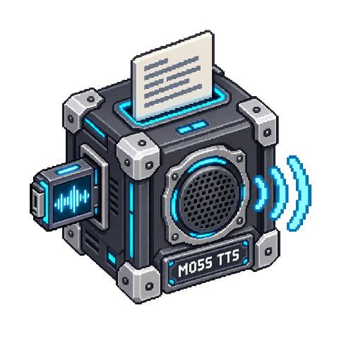

# MOSS-TTS-v1.5



<!-- block-metadata:start -->
[](model.json)
[](compatibility.json)
[](LICENSE)

Verified BloxSmith versions: **1.0.9** (bundled-block tests; see [test evidence](compatibility.json)).
<!-- block-metadata:end -->


Run the actual **OpenMOSS-Team/MOSS-TTS-v1.5** model and its **MOSS-Audio-Tokenizer** locally. This is the original 8B delay-pattern model, not MOSS Realtime, Nano or a hosted speech API. No API key, agent CLI or cloud fallback is used.

## Connect it

| Port | Direction | Contract |
| --- | --- | --- |
| `text` | Input | Plain text, or an `application/json` object containing exactly `text` and `request_id`. |
| `command` | Input | JSON `{"action":"interrupt"}`. In Active Runtime, cancel the owned job and discard older pending requests. |
| `audio_file` | Output | Absolute path of a uniquely named, complete WAV or Ogg/Opus file. |
| `metadata` | Output | Request ID, model/codec revisions, format, sample rate, duration, byte count, SHA-256 and completion information. |
| `status` | Output | `completed`, interruption/queue state or a safe recoverable error code. |

An ordinary text string is always speech, even if it looks like JSON. Commands belong on their separate port. IDs correlate results; they are not durable deduplication keys. Repeating a request is another synthesis. Port names, not their visual order, select behavior.

This package does **not** expose a live `audio_stream` port. A completed file path is not an audio transport frame. Do not wire it directly to an audio-only player. A file-to-stream adapter must explicitly handle that transition.

## Local prerequisites

- Linux, FFmpeg and an explicitly prepared **Python 3.12** environment. Install the pinned [requirements](requirements.txt) there, not into the framework. Select matching CPU or CUDA PyTorch wheels for the host.
- **24,094,471,409 bytes** of pinned model, codec and tokenizer files, plus dependency and working space. They are downloaded separately, never bundled in Git or installed when adding the block or preparing a Run.
- Sufficient available RAM and, for CUDA, VRAM. The 8.49B-parameter language/audio model uses bfloat16 or float32; the 1.77B-parameter codec remains float32. CPU float32 weights alone require roughly 41 GB before activations. CUDA bfloat16 weights total roughly 24.1 GB before working memory. These are weight inventories, not measured peak-memory or latency promises.

Prepare assets explicitly in an operator-selected directory:

```sh
# Read-only inventory and disk-space preflight; no downloads or directory creation.
python setup_model.py --directory MODEL_ASSETS

# Explicit download, if sufficient space is available.
python setup_model.py --directory MODEL_ASSETS --download-public
```

The [asset manifest](model_artifacts.json) pins every file to immutable upstream revisions, sizes and SHA-256/LFS or Git-blob checksums. Downloads accept only bounded official HTTPS redirects. Existing corrupt files are refused, not replaced. Runtime verifies the entire local snapshot and rejects undeclared files inside `model/` or `codec/` before loading it. Keep those directories unchanged during execution.

The model uses custom Python code: `trust_remote_code` is enabled **only for those verified local snapshots**, inside a supervised child process. That is a dependency trust decision, not an OS security sandbox. Hub access is disabled and all loading paths are local. Dynamic-module and library caches belong to the private job directory. No audio or text is uploaded.

The pinned upstream processor passes loader options to a constructor that rejects them under Transformers 5.0. The adapter therefore loads the verified processor class, tokenizer, config and codec explicitly, without changing upstream files. It uses the native generation and codec methods.

## Settings

The modal and inspector share draft settings: **Apply** persists, **Cancel** discards. Controls remain labelled and scrollable at narrow widths. Reload a prepared Run after changing configuration.

- **Language:** automatic, or a language declared by v1.5: Chinese, Cantonese, English, Arabic, Czech, Danish, Dutch, Finnish, French, German, Greek, Hebrew, Hindi, Hungarian, Italian, Japanese, Korean, Macedonian, Malay, Persian, Polish, Portuguese, Romanian, Russian, Spanish, Swahili, Swedish, Tagalog, Thai, Turkish or Vietnamese. These are upstream capabilities, not a multilingual accuracy certification by this block.
- **Optional voice reference:** a completed, non-silent local WAV/Ogg/WebM/FLAC/MP3/M4A/MP4 clip, 0.5–30 seconds and at most 32 MiB. Use voices you are authorized to reproduce. The block snapshots and converts the reference to 24 kHz mono without modifying or silently cropping the source. Without a reference, the model chooses a voice; stable identity across requests is not guaranteed.
- **Target duration:** 0 for automatic, otherwise 0.08 seconds up to the maximum duration. Converted to the model's 12.5-Hz audio-token condition; it is a target, not an exact duration guarantee. Native inline pause and pronunciation notation stays in the input text.
- **Device/precision:** explicit CUDA bfloat16 or float32; CPU float32 only. No silent device or precision fallback. A weight-based RAM/VRAM preflight supplements the configurable available-RAM threshold; memory is not reserved.
- **Format:** complete mono PCM16 WAV at 24 kHz, or Ogg/Opus encoded at 48 kHz. The neural output is converted to PCM16; samples outside the PCM range are clipped and counted in `clipped_samples`. Invalid/non-finite, excessively out-of-range or entirely silent generated audio is refused.
- **Advanced controls:** separate text/audio temperature, top-p and top-k, plus audio repetition penalty. These are native sampler controls, not invented voice/emotion options. Zero temperature selects greedy decoding; zero top-k disables that filter.
- **Bounds:** default 1,000 text characters, 1,024 generation steps, 60 seconds of output, 16 audio regions, 240-second whole-request deadline and four pending requests. Configurable ranges are declared in `fields.json` and validated before side effects. The total model context window is checked too.

## Execution and interruption

Simulation/One Shot runs one bounded synthesis synchronously. Active Runtime starts a lightweight public listener; it loads no weights until new text arrives. One synthesis runs at a time, with a bounded pending queue. A limit of zero rejects new text while busy. An accepted interrupt cancels the current owned process and clears earlier pending requests; later text can start another job. It does not stop a downstream player that has already received a previous file.

The model is loaded anew for each request; this implementation is **not a warmed low-latency server**. Conversion, integrity checks, loading, inference, final encoding and publication all share the request deadline. Stop and abrupt host death fence the owned process group. No global process termination or framework modification is used.

Before decoding, the adapter checks the assistant EOS, balanced complete audio regions and all 32 delayed RVQ channels. It decodes each region separately because the codec's chunked method supports batch size one. All regions are preserved in order. A missing EOS or exhausted duration/token limit produces no file. EOS proves protocol completion, not correct pronunciation or that the model spoke every requested word.

Publication occurs only after the listener checks pending interruptions. Unique atomic publication never overwrites existing files. Empty output directory uses this node's persistent `audio/` directory through the public block-storage service. Published files survive Runs; there is no automatic cleanup. Normal jobs remove temporary copies; abrupt host termination may leave unreferenced private job directories, never published as completed audio.

## Verification scope

Block tests cover asset integrity and refusal, native adapter arguments, complete/incomplete multi-region delay patterns, optional reference bounds, genuine subprocesses and FFmpeg codecs, cancellation/parent death, both runtimes in bundled/managed/linked installations, and English/French responsive modal/inspector behavior. **Model/codec doubles are explicit**: passing these suites does not qualify actual MOSS inference, voice quality, hardware memory use or throughput.

Actual-model qualification remains pending: the current test host lacks the storage/GPU environment for this 24.1 GB snapshot. On a prepared host:

```sh
# Read-only prerequisite inventory by default.
python tests/qualify_model.py --directory MODEL_ASSETS --python INFERENCE_PYTHON

# Explicit real English/French inference; optional --reference AUTHORIZED_AUDIO.
python tests/qualify_model.py --directory MODEL_ASSETS --python INFERENCE_PYTHON \
  --execute --results-directory TEST_RESULTS
```

Listen to the complete samples and separately record hardware, runtime/Stop behavior and measured resources. The helper never downloads weights. The proprietary framework test harness is not redistributed here.

## Upstream and license

Block code: Apache-2.0. The selected MOSS model, codec and custom code declare Apache-2.0 upstream and are obtained separately. No provider logo or model weights are bundled.

- [MOSS-TTS-v1.5 model and interface](https://huggingface.co/OpenMOSS-Team/MOSS-TTS-v1.5/tree/cdd3b911b1585e3f2dbc7775ef10f9926f58850a)
- [MOSS-Audio-Tokenizer snapshot](https://huggingface.co/OpenMOSS-Team/MOSS-Audio-Tokenizer/tree/3cd226ba2947efa357ef453bcad111b6eafba782)
- [Official MOSS-TTS project](https://github.com/OpenMOSS/MOSS-TTS)
